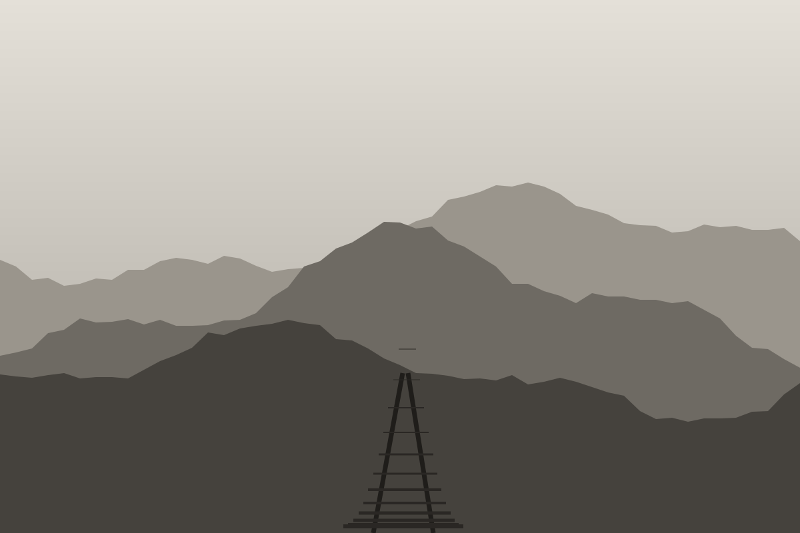

# The page

## Sepia paper, ink, one red

Slides are set like a page of typed notes: sepia paper, near-black ink, and
a seal red kept for the rare thing that matters.

Headings are Fraunces at its display size. Body text is Courier Prime.

## Text keeps to the left

Everything sits in a column on the left of the page, leaving a wide margin
on the right.

- column width: `$text-measure`
- space above: `$page-top`

## Two body styles {.print}

This slide is set in the **print** style: Fraunces at its small text size,
sturdier and quieter than the headings.

- deck-wide: `$body-style: "print"` at the top of the theme
- one slide: `## Title {.print}` (or `{.typed}`)

# Marking things

## Highlights

- the main point gets [the highlighter]{.mark}
- a secondary one gets [a red-pencil underline]{.ul}
- something [wrong]{.red} gets red ink
- *italics* and **bold** as usual

::: {.note}
`[text]{.mark}` · `[text]{.ul}` · `[text]{.red}` — `.hlg` (Imago's
highlighter) works too.
:::

## {.unnumbered}

::: {.passage}
In the spring of the thirteenth year of Shōwa, I was invited to Taiwan. My
hosts expected lectures; I wanted only to eat.

Each morning the city announced itself first by smell, then by sound, and
only last by sight.
:::

::: {.note}
`::: {.passage}` — running text set like a page of the book.
:::

# Images

## Text left, plate right

:::: {.columns}
::: {.column width="45%"}
Images are printed onto the paper: greyscale, a little warm, with a hairline
edge and a typed caption.
:::
::: {.column width="55%"}

:::
::::

## An image in the margin

A single image can step out into the right-hand margin with `{.right}`. The
text column narrows to make room.

{.right}

## Across the page

{.wide width=70%}

## {.vcentre}

{width=50%}

# Tuning it

## The knobs

At the top of `travelogue.scss`:

- palette: `$paper` `$ink` `$accent` `$highlight`
- body: `$body-style`
- page: `$text-measure` `$page-top`
- margin images: `$text-measure-beside-image`
