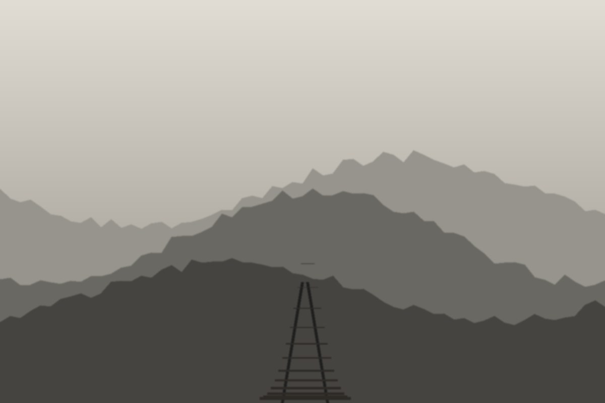

## What we're asking

- can a picture of a place tell us [about the people]{.mark} in it?
- what does the model *see* that we [don't]{.ul}?
- and where does it get things [wrong]{.red}?

## {.unnumbered}

::: {.passage}
In the spring of the thirteenth year of Shōwa, I was invited to Taiwan. My
hosts expected lectures; I wanted only to eat.

Each morning the city announced itself first by smell, then by sound, and
only last by sight.
:::

## A landscape, from above

:::: {.columns}
::: {.column width="45%"}
Text keeps to the left of the page.

The image sits to its right, like a plate.
:::
::: {.column width="55%"}

:::
::::

## An image in the margin

Short notes stay in the text column; a single image can step out into the
right-hand margin with `{.right}`.

{.right}

## Three things to take away

1. embeddings are a lens, not a map
2. ground truth is local
3. read the residuals

::: {.note}
`[text]{.mark}` highlighter · `[text]{.ul}` red-pencil underline ·
`[text]{.red}` red ink · `::: {.passage}` running text ·
`{.right}` image in the right margin · `{.wide}` full-width image ·
`{.full}` borderless image · `{.colour}` keep image colour ·
`:::: {.columns}` text left, image right
:::
